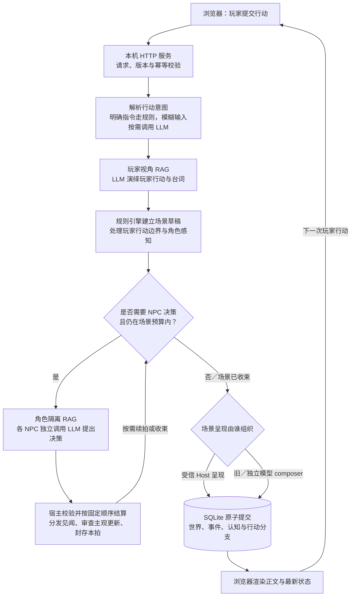

# 魔法少女的魔女裁判：高墙之内


> **「欢迎来到关押魔女的牢笼。在这里，每一句证言、每一次踱步、每一道紧锁的铁门，都有真实的代价。」**

《魔法少女的魔女裁判：高墙之内》（`manosaba-within-the-walls`）是《魔法少女的魔女裁判》的非官方同人文字 RPG。在这里，你可以化身原作中的少女，也可以捏一个属于自己的角色踏入这座孤岛监狱——用自由输入的文字与众人交谈、在各处探索、搜集线索、走上审判席。这座牢笼里的每个角色都有自己独立的 Agent 思维，而你做出的每一个举动，都会由背后的规则引擎给出真实的裁定。

*目前游戏处于实验版本，已经可以体验日常互动、部分案件流程、随时存读档与行动回溯，但还不是一个无所不能的完全自主世界。*

想开发新功能或修复 Bug？从[开发与贡献指南](CONTRIBUTING.md)开始：用隔离存档启动、跟做一个 UI 功能、编写回归测试，再向项目提交 PR。

**文字行动施法：** 新建普通游戏时，可在角色的魔法设定中写下本局使用的能力；游玩时仍在同一个行动框输入动作，不需要术名或独立施法面板。本版已接通短暂可见的效果，以及牵手带一位在场同伴穿梭。以八云晓为例，牢门上锁时也可以牵着艾玛，在脑海里清楚构筑医务室并直接穿梭过去；穿梭不等于开门或获得医务室留宿许可。已有存档和原有编译能力沿用各自的规则。

---

## 登场少女与监牢全员

你可以选择扮演 **13 位原作少女** 中的任意一位开启故事，也可以创建原创角色加入她们（典狱长为固定 NPC，不可作为玩家扮演）：

|  |  |  |  |  |  |  |
| :---: | :---: | :---: | :---: | :---: | :---: | :---: |
| **樱羽艾玛** | **二阶堂希罗** | **夏目安安** | **城崎诺亚** | **莲见蕾雅** | **佐伯米莉亚** | **宝生玛格** |
|  |  |  |  |  |  |  |
| **黑部奈叶香** | **紫藤亚里沙** | **橘雪莉** | **远野汉娜** | **泽渡可可** | **冰上梅露露** | **典狱长（NPC）** |

---

## 技术栈

程序不需要额外安装 npm 依赖或手动构建。运行需要 **Node.js 24+**；游玩前需配置可用的模型服务。

| 模块 | 实现方案 | 说明 |
| :--- | :--- | :--- |
| **语言与运行时** | JavaScript（ES Modules） | 基于 **Node.js 24+** 原生运行，无需构建编译步骤 |
| **前端界面** | 原生 HTML / CSS / JS | 直接用浏览器 ES Modules 组织界面、音效与演出，不依赖外部框架 |
| **本机后端** | Node.js 内置 `node:http` | 提供本机回环 HTTP 服务与 JSON API，不依赖 Express 等外部库 |
| **数据存储** | Node.js 内置 `node:sqlite` | 本地 SQLite 事务化存储世界状态、角色认知、存档与回溯分支 |
| **模型接入** | OpenAI-compatible / Anthropic | 既支持连接远程大模型 API，也支持接入兼容协议的本机模型服务 |
| **角色记忆（RAG）** | 自研认知检索 + SQLite FTS5 | 严格按“是谁、在哪条时间线、何时获知”隔离每位少女的见闻与记忆 |

---

## 架构设计


游戏采用**本地运行、浏览器游玩**的单体结构：后台由 Node.js 跑起一个只监听本机回环地址的服务，前端在浏览器里呈现画面，所有存档数据都落在本地 SQLite 里。

- **交互层（`public/`）**：负责呈现眼前的场景正文、角色立绘、魔女图鉴（手机菜单）、历史日志与设置面板，把你的行动传达给本机服务。
- **回合编排（`server.mjs` / `llm-turn-runner.mjs` / `prologue.mjs`）**：负责校验请求、解析你的行动意图、演绎玩家表现、按节拍调度在场 NPC，最后编排成完整的场景正文。每一步子任务都会落地保存，万一网络波动失败了，手动重试时也能直接续上。
- **角色 Agent 与 RAG（`rag-context.mjs` / `cognition-store.mjs`）**：专门负责“给每个角色发她自己那份剧本”。少女们只知道自己亲眼所见、亲耳所闻的事，怀揣各自的记忆、目标与主观信念，绝不会偷偷共享全知视角或别人的秘密。
- **规则引擎（`scene-beats.mjs` / `agent-autonomy.mjs` / `case-runtime.mjs` / `case-procedure.mjs`）**：这座监狱里的“铁律”，负责校验行动条件，结算移动、时间流逝、物品归属、证据取得与案件流程。哪怕同一拍里有好几个角色同时思考，实际动手时也会按固定顺序一一裁决。
- **持久化（`domain-store.mjs` / `agent-turn-store.mjs`）**：把世界事件、角色认知、存档和回溯分支全部记录在案；每一轮的最终世界变化都在 SQLite 事务里原子提交，不留烂摊子。

### 相比传统 SillyTavern 玩法的优势


SillyTavern 是非常优秀的通用聊天与角色扮演前端，而本项目则是专门围绕《魔女裁判》打造的一套**带规则的游戏运行时**。如果拿它和常见的“角色卡 + 世界书 + 纯聊天记录（未外接权威规则引擎）”玩法相比，最大的不同在于：**这里不只是让模型顺着往下编故事，而是让你的每个举动都在一个有规则、有状态的真实世界里产生后果。**

| 维度 | 传统纯聊天角色扮演（无外部规则引擎） | 《高墙之内》带规则运行时 |
| :--- | :--- | :--- |
| **世界状态** | 靠上下文记忆，聊久了容易出现穿墙、物品凭空消失或设定前后矛盾 | 位置、门锁、证物归属与案件阶段由代码和数据库维护，规则不允许就不会发生 |
| **认知隔离** | 把完整设定塞进提示词，再要求模型“假装不知道”，容易串台或提前看穿真相 | 先按角色、历史分支和获知时间过滤见闻再组装上下文，从根源避免未卜先知 |
| **群像交互** | 角色大多轮流接话，互动很难真正改变地图局势与事件走向 | 角色拥有独立的持久化目标与信念，被场景唤醒后可提出交谈、移动等行动并经规则结算 |
| **回溯读档** | 删改聊天记录后，往往还要手动叮嘱角色“忘掉刚才的事” | 世界状态、事件与角色脑内的认知沿同一历史路径精确退回，废弃分支的未来记忆不会残留 |
| **容错恢复** | 复杂回合中途断网容易丢失进度，或者把半截残文当成既定事实 | 子任务独立校验保存、最终结果原子提交；报错不污染世界，点重试可直接复用已跑通的步骤 |

当然，这套机制主要追求的是**长线状态不崩、群像互动更真、因果推理有据可依**，并不代表文笔或脑洞一定比纯自由聊天更强。它的代价也很实在：你走一步，背后可能要请求好几次模型，等待时间和开销都会高一些；而且新玩法必须配套写好规则和数据，没法像换张角色卡那样随便塞进任何世界，也无法做到 100% 消灭模型幻觉。

### 系统流程

下面这张图展示了平时你输入一个普通行动后，幕后发生的一整套流转（案件搜查、法庭投票等特殊环节会走专门的规则分支）：



简单来说：**LLM 只负责“提议要做什么”和“把画面写得好看”，真正能改写世界的只有规则引擎。** NPC 的连续反应也有明确的预算上限；只要你还没输入下一步，游戏就绝不会随着现实时间流逝在后台偷偷推进剧情。每个存档还会绑定对应的内容与规则版本，老存档不会因为游戏更新而在暗地里被换掉规则。

---

## 项目结构

```text
manosaba-within-the-walls/
├─ public/          # 原生前端页面、界面脚本与样式
├─ public/assets/   # 按用途分类的游戏素材（界面、立绘、背景与音乐等）
├─ src/             # 本机 HTTP 服务、回合编排、角色认知与世界／案件规则
├─ data/            # 角色场景、监狱规则、角色卡与心理初始配置
├─ scripts/         # 启动器与运行引导脚本
├─ package.json     # Node.js 版本要求与启动入口
└─ 开始游戏.cmd      # Windows 一键启动入口
```

所有画面与声音素材都整整齐齐地归类在 `public/assets/` 下，按用途分为 `start`（标题与开始画面）、`ui`（通用控件与对话框）、`menu`、`saveload`、`witchbook`（魔女图鉴）、`trial`（审判席）、`characters`（角色立绘与头像）、`execution`（处刑演出）、`fonts`、`items`、`backgrounds`（场景背景）和 `audio`（背景音乐）。

你的个人存档和模型配置默认保存在系统用户目录里，和游戏本体分开存放。需要注意：`data/` 和 `public/assets/` 里装的都是运行必需的数据与素材，千万不要随手删掉；相关素材的来源说明保存在 `data/card-source.json`、`data/ost-catalog.json`、`src/host/static-assets.mjs` 以及素材目录的 provenance 文件中，素材权利归各自原作者所有，如果想把整合包分享给别人，请务必先核对相关许可。

---

## 使用方法


### 1. 启动游戏

本作需要 **Node.js 24+** 环境。

- **Windows 一键启动（推荐）**：直接双击根目录下的 **`开始游戏.cmd`**。启动器会自动帮你检查运行环境和素材，如果发现电脑里还没装 Node.js 或缺少部分第三方 UI 素材，它会尝试帮你安装与下载，一切就绪后会自动弹开浏览器进入游戏（首次运行可能需要联网和管理员权限确认）。
- **命令行启动**：如果你习惯自己管理环境，也可以先装好 [Node.js](https://nodejs.org/)，然后在项目根目录打开终端运行：

```powershell
npm start
```

看到服务启动后，用浏览器打开 [http://127.0.0.1:3211](http://127.0.0.1:3211) 就能开始玩了。游玩期间请保留后台的启动窗口，不玩的时候在窗口里按 `Ctrl+C`（或使用图形启动器的停止按钮）即可关闭服务。

### 2. 配置模型并开始游玩

1. **接好大脑（配置模型）**：进入游戏后先点 `Options`，添加你的模型节点，填好接口地址、协议类型、模型 ID 和 API Key，然后**保存并激活预设**。你可以省心地把所有环节都交给同一个“默认通用模型”，也可以讲究一点，给意图解析、玩家演绎、角色对白和旁白分别指定最擅长的模型（场景编排会自动复用旁白模型）。
2. **踏入高墙（开局或续玩）**：回到主界面点 `New Game`，既可以选择扮演 13 位原作少女之一，也可以亲手捏一个自定义角色，挑好周目和开场就能进入牢房；如果之前玩过，直接继续或读取存档即可。
   - 可以手写关系，也可以主动调用**开局关系助手**。助手给出的候选可以逐条编辑或丢弃；只有点“采用”才替换当前关系草稿，不会替你建局或存档。**导演偏好**可以写想要的节奏，例如“多给我观察和交流的机会”；它是导向，不替你行动，也不会给角色透露他们尚未获知的线索。
3. **自由行动**：输入此刻想做的事，比如 `观察四周`，或者 `观察四周，然后对希罗说：“这里真安静。”`。普通行动按现场规则结算。能明确认出接收者和你想说的话时，演绎会按你扮演的角色润色口吻；模型漏写或改偏时，游戏用你的原话继续。角色是否听见、怎样回应，仍取决于现场和角色自己的选择。
   - **阅读每回合的场景**：观察、走动、等待、交谈和调查都会写成玩家视角的中文轻小说场景。默认旁白在材料充足时，日常约 300–600 汉字，较丰富的场面约 600–1000 汉字；对白和已发生的事件另计。线索少时会自然收住，不会为了字数多走一步或多发现一件证物。可在 `Options` 的旁白提示词里调整偏好；如果已经写过自己的旁白提示词，仍沿用你的版本。
4. **善用图鉴与回溯**：随时点开画面上的手机菜单，就能翻看历史日志、查阅魔女图鉴或是存读档。如果对刚才那一拍的发展不满意，可以在行动楼层上直接点“回到行动前”或者“重新生成”——重Roll完全跑通之后才会切换过去，而且会自动帮你把原来的进度备份好，尽管放心尝试。

> **模型开销与续接。** 一个行动可能触发多次模型调用，费用以你选的服务为准；远程模型会收到本轮所需的上下文。如果界面明确提示有未完成的请求，先核对进度，再选择**续接原请求**，继续原时限和已记录任务。**另开新尝试**会创建新请求并可能再次产生费用；**重新生成**则针对已经结算的行动，不是继续上次未结束的请求。

### 3. 本机存档与数据备份

游戏默认会把你的所有家当存放在 `%USERPROFILE%\.manosaba\llm-test-v1` 目录下，里面装着世界数据库 `world.sqlite` 和独立的模型配置。

- **密钥安全**：你填写的 API Key 会通过 Windows DPAPI 进行加密，与你当前的 Windows 账户绑定。所以就算把存档文件夹拷给别人，对方也是没法直接盗用你的密钥的。
- **如何备份**：平时想备份存档的话，记得**先停止游戏服务**，然后把整个数据目录完整复制一份就行。
- **自定义路径与端口**：如果你是通过命令行 `npm start` 启动的，可以通过设置环境变量 `MANOSABA_DATA_DIR` 和 `PORT` 来自由指定数据存放位置与监听端口。
**Windows：隔离试玩与读档**。在发行目录打开 PowerShell。标题页左上角显示实际运行版本；如果同时留有多个发行目录，可用这个标签确认打开的是哪一版。先停掉旧实例，再设置新的试玩数据目录，例如：

```powershell
$env:MANOSABA_DATA_DIR = Join-Path $env:USERPROFILE 'Manosaba-local010-play'
$env:PORT = '3211'
npm start
```

需要复用同一 Windows 账户的既有模型预设、又不想让试玩修改它时，可在启动前另外将 `MANOSABA_MODEL_SETTINGS_READONLY_DIR` 设为既有配置的**绝对目录**，同时保留上面的显式试玩数据目录。该模式只读配置，不复制配置文件或密钥；远程调用仍使用已启用的预设、会受该服务的配额和计费规则约束。若要管理新配置，不设置这个变量，直接在试玩目录对应的游戏界面配置。

退出前用游戏内存档并记下槽名；`Ctrl+C` 结束服务后，使用同一发行目录和同一数据目录再启动。在标题选择读取存档，明确点选该槽（不要把“继续”当作读取该槽），确认读入后再提交一个新的行动。如果上次仅显示请求未完成，没有结算提示，先核对当前进度；只有要保留该请求时才按界面提供的手动续接，不要连按并重复发出。

**回退时恢复整份资料备份。** 更新前停掉游戏，把旧发行目录和完整数据目录分别保留。要回退时先停掉新版本；保留新版本用过的资料目录供排查，然后用旧发行目录和**更新前**的完整数据备份启动。不要把旧程序指向已经被新版写过的数据，也不要只取运行中的 `world.sqlite` 来覆盖存档。

**本版已知限制。** 案件依靠角色选择、实际线索与条件推进；真实模型游玩从触发到结案并冷续的完整一局尚未验收，普通游玩不要求触发案件。历史 Windows 普通游玩样本 30 次首提交中 29 次可用；成功样本的轻量回合中位约 62 秒、p95 约 76 秒，复杂回合 p95 约 94 秒。这是历史样本，不是当前机器、服务或发行目录的速度承诺。真实等待与自动重试表现未验；选择手动续接前先核对当前进度。早期发行包的七项逐字对照未执行，不等于否定已有存档的恢复覆盖。

### 4. 在 GitHub 反馈问题

1. 复现问题后，在游戏目录双击 [提取反馈日志.cmd](./提取反馈日志.cmd)。游戏开着或已关闭都可以，**不用打开 Debug**。
2. 若提示里有「日志编号」，把它粘贴进去，可导出该编号和同次运行前后约 2 分钟的操作记录；直接按回车则导出最近最多 200 条。工具会显示 TXT 文件的保存位置，默认在游戏资料目录的 `feedback` 子目录。
3. 打开 TXT 确认后，回到你下载本项目的 GitHub 仓库，在 **Issues → New issue** 或现有 Issue 的评论框中拖入 TXT，再补充发生时间、最短复现步骤、预期和实际结果。工具只生成本地文件，不会自动上传。

如果启动时用了自定义资料目录，在发行目录执行 `node scripts/export-feedback.mjs --data-dir "你的资料目录"`，也可加 `--correlation-id "日志编号"` 定向提取。报告保留版本、时间、状态码和失败阶段等诊断信息；不读取存档、模型配置或私有 Debug 日志，不导出密钥、玩家输入、提示词或模型原文。请勿把整个资料目录或 `debug-traffic.jsonl` 拖进公开 Issue。若游戏在写出操作日志之前就退出，请改附启动器的报错和发生时间。
